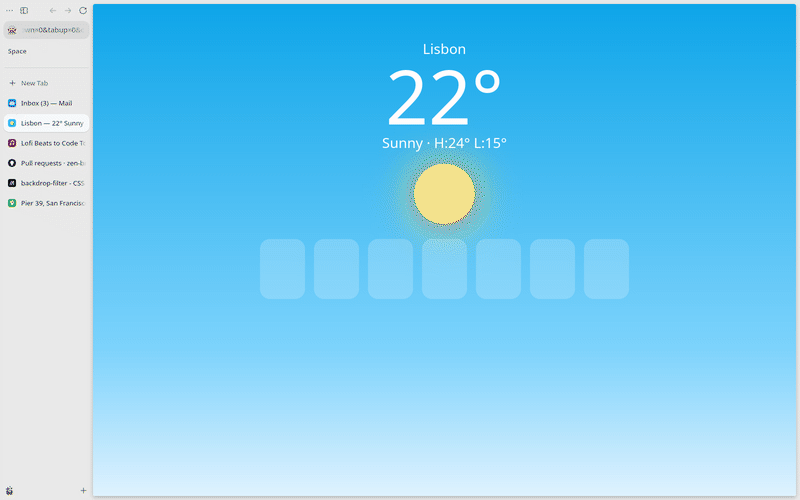
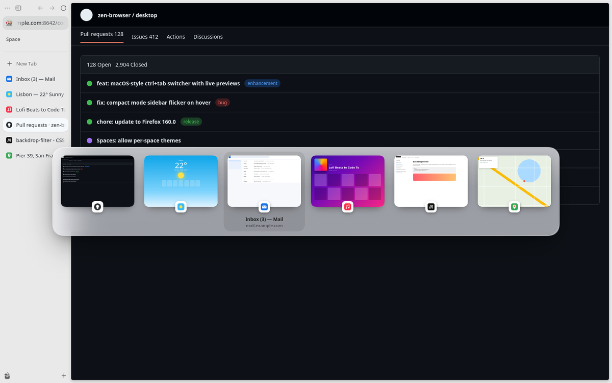

# Zen Mac Tab Switcher

A macOS Cmd+Tab–style Ctrl+Tab switcher for [Zen Browser](https://zen-browser.app).



| Light | Dark |
| --- | --- |
|  |  |

## What it does

- Hold **Ctrl** and tap **Tab**. A frosted-glass panel appears in the middle of the window with live previews of your tabs, most recently used first. Each preview has a favicon badge, and the highlighted tab shows its title and site.
- Spring animations throughout. The panel pops in, the highlight glides between previews, and when you release Ctrl the chosen preview zooms into the page, like clicking a window in Mission Control.
- A quick Ctrl+Tab tap switches to the previous tab without showing the panel, the same as a quick Cmd+Tab on macOS.
- Fits into Zen: it follows Zen's light/dark theme, lists only the current Space's tabs (plus Essentials), and works with split view, pinned tabs and fullscreen video. It respects the system "Reduce motion" and "Reduce transparency" settings.

## Controls (while holding Ctrl)

| Key / mouse | Action |
| --- | --- |
| Tab, →, ↓ | Next tab |
| Shift+Tab, `` ` ``, ←, ↑ | Previous tab (Ctrl+Shift+Tab from nothing starts at the last tab) |
| Home / End | First / last tab |
| Release Ctrl, Enter, click | Switch to the highlighted tab |
| Hover | Highlight that tab |
| W or Q | Close the highlighted tab (pinned tabs follow Zen's close setting, which by default unloads them instead of closing) |
| Middle click | Close that tab |
| Esc | Cancel |

## Install (Windows, one click)

Run `installer/ZenMacTabSwitcher-Setup.exe`. It finds Zen and your profile by itself, installs everything, and clears Zen's startup cache.

1. Close Zen.
2. Run the installer and click **OK**. If Zen is in `Program Files`, Windows asks for administrator permission once.
3. Start Zen, hold Ctrl and press Tab.

Run it again to **update** or **uninstall** (it asks which). Uninstalling keeps the loader if you have other userChrome scripts.

It finds Zen through the running process, Windows' installed-apps list, Zen's registry keys and the default folders. Options: `/S` (silent), `/uninstall`, `--zen-dir "C:\path\to\Zen Browser"`, `--profile "C:\path\to\profile"`. It refuses to run if Zen is open or if Sine is installed, and changes nothing in those cases.

Build it yourself with `installer/build.sh` (Go 1.25+, works from Linux, macOS or Windows).

## Install by hand (macOS, Linux, or without the installer)

Zen has no built-in way to run custom scripts, so this uses [fx-autoconfig](https://github.com/MrOtherGuy/fx-autoconfig), the standard userChrome.js loader for Firefox-based browsers.

1. Download fx-autoconfig (**Code → Download ZIP**) and unzip it.
2. Quit Zen.
3. Find Zen's install folder:
   - **macOS:** `/Applications/Zen.app/Contents/Resources/` (right-click Zen.app → Show Package Contents)
   - **Windows:** `C:\Program Files\Zen Browser\` (next to `zen.exe`)
   - **Linux:** the folder that contains the `zen` binary (tarball or extracted AppImage)

   From fx-autoconfig's `program` folder, copy `config.js` into that folder, and `defaults/pref/config-prefs.js` into its existing `defaults/pref/` folder. Copy the file, not the whole `defaults` folder: Zen keeps `channel-prefs.js` there, and Finder replaces folders instead of merging them.
4. Open Zen, go to `about:support`, and next to **Profile Folder** click **Open Folder** (macOS: **Show in Finder**). Quit Zen again.
5. In the profile folder, create a `chrome` folder if there isn't one. Copy the `utils` folder from fx-autoconfig's `profile/chrome/` into it, and create an empty `JS` folder next to it.
6. Put `zen-mac-tab-switcher.uc.js` into `chrome/JS/`. The result looks like this:
   ```
   <profile>/chrome/utils/boot.sys.mjs   (and the other files from fx-autoconfig)
   <profile>/chrome/JS/zen-mac-tab-switcher.uc.js
   ```
7. Start Zen, open `about:support`, click **Clear startup cache…** and confirm. Zen restarts with the switcher active.

It works whether or not Zen's own "Ctrl+Tab cycles through tabs in recently used order" setting is on.

## Settings

All optional. Create them in `about:config` with the type shown. Changes apply the next time you press Ctrl+Tab.

| Preference | Type | Default | Meaning |
| --- | --- | --- | --- |
| `zen.mac-tab-switcher.enabled` | Boolean | `true` | Turn the switcher off without removing it (Zen's normal Ctrl+Tab comes back) |
| `zen.mac-tab-switcher.show-delay-ms` | Number | `150` | How long Ctrl+Tab must be held before the panel appears |
| `zen.mac-tab-switcher.max-tabs` | Number | `24` | Most tabs shown; the strip scrolls when they don't fit |
| `zen.mac-tab-switcher.transition` | String | `zoom` | Tab change animation: `zoom`, `fade` or `none` |
| `zen.mac-tab-switcher.glass` | String | `auto` | Background blur: `auto` (off when Zen renders without a GPU), `on`, `off` |
| `zen.mac-tab-switcher.select-on-hover` | Boolean | `true` | Highlight a preview when the mouse moves over it |

Zen's own settings in **Settings → Tabs** also apply: "Ignore Pending tabs when cycling with Ctrl+Tab" and "Ctrl+Tab cycles within Essential or Workspace tabs only".

## Uninstall

Delete `chrome/JS/zen-mac-tab-switcher.uc.js`, then clear the startup cache in `about:support`. To remove fx-autoconfig as well, delete `config.js` and `defaults/pref/config-prefs.js` from Zen's install folder and `chrome/utils` from the profile.

## Things to know

- **Zen updates:** updating Zen on macOS replaces Zen.app and removes `config.js` and `config-prefs.js`. Copy them back after each update (step 3). The files in your profile are kept.
- **Flatpak (Linux):** the install folder is read-only, so step 3 isn't possible there.
- **Sine:** Sine uses its own loader in the same place (`config.js`, `chrome/utils`). Installing fx-autoconfig over it breaks Sine.
- **Unloaded tabs** can't be rendered, so they show their favicon until you visit them again.
- **Tested** with Zen 1.24.2b (Firefox 160) on Linux. It has not been run on macOS or Windows hardware.

## Project info

- **Description:** Just ctrl+tab and see the magic in Zen Browser
- **Suggested GitHub topics:** `zen-browser`, `firefox`, `tab-switcher`, `ctrl-tab`, `userchrome`, `userchrome-js`, `fx-autoconfig`, `javascript`, `macos-style`, `go`, `windows-installer`
- **Version:** 1.0.0 (see [CHANGELOG](CHANGELOG.md))
- **License:** none specified yet. The bundled `installer/assets/fx/` files carry their own license (fx-autoconfig).
