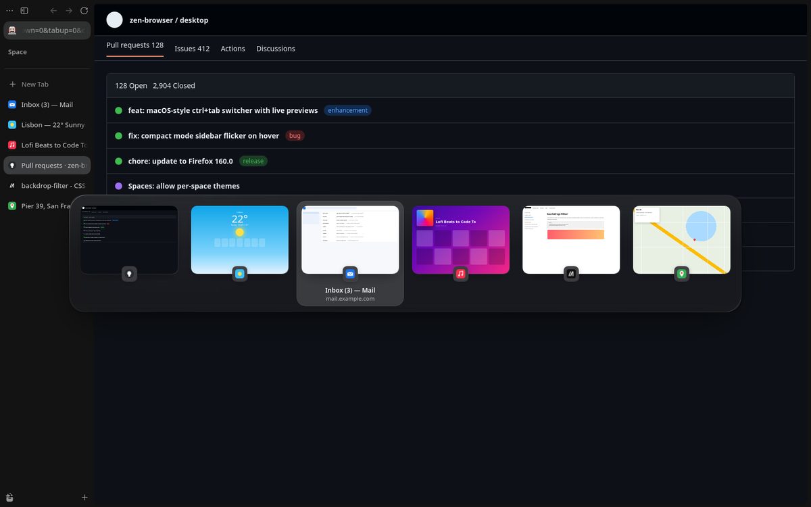

# Zen Mac Tab Switcher

A macOS Cmd+Tab–style Ctrl+Tab switcher for [Zen Browser](https://zen-browser.app).


| Light | Dark |
| --- | --- |
|  |  |

## What it does

- Hold **Ctrl** and tap **Tab**. A frosted-glass panel appears in the middle of the window with live previews of your tabs, most recently used first. Each preview has a favicon badge, and the highlighted tab shows its title and site.
- Spring animations throughout. The panel pops in, the highlight glides between previews, and when you release Ctrl the chosen preview zooms into the page, like clicking a window in Mission Control.
- A quick Ctrl+Tab tap switches to the previous tab without showing the panel, the same as a quick Cmd+Tab on macOS.
- Fits into Zen: it follows Zen's light/dark theme, lists only the current Space's tabs (plus Essentials), and works with split view, pinned tabs and fullscreen video. It respects the system "Reduce motion" and "Reduce transparency" settings.

## Controls (while holding Ctrl)

| Key / mouse | Action |
| --- | --- |
| Tab, →, ↓ | Next tab |
| Shift+Tab, `` ` ``, ←, ↑ | Previous tab (Ctrl+Shift+Tab from nothing starts at the last tab) |
| Home / End | First / last tab |
| Release Ctrl, Enter, click | Switch to the highlighted tab |
| Hover | Highlight that tab |
| W or Q | Close the highlighted tab (pinned tabs follow Zen's close setting, which by default unloads them instead of closing) |
| Middle click | Close that tab |
| Esc | Cancel |

## Install

**[Download the latest release](https://github.com/ayyfahim/Ctrl-Tab-Zen/releases/latest)** and close Zen first. Every installer finds Zen and your profile by itself, installs everything and clears Zen's startup cache. Run it again to **update** or **uninstall** (it asks which).

| System | Download | How |
| --- | --- | --- |
| Windows (x64) | `ZenMacTabSwitcher-Setup.exe` | Run it and click **OK** |
| Windows (ARM) | `ZenMacTabSwitcher-Setup-arm64.exe` | Run it and click **OK** |
| macOS | `ZenMacTabSwitcher-macOS.zip` | Unzip, right-click **Install Zen Mac Tab Switcher.command** → **Open** |
| macOS / Linux | one terminal command | see below |

Then start Zen, hold Ctrl and press Tab.

### macOS and Linux: one command

```sh
curl -fsSL https://github.com/ayyfahim/Ctrl-Tab-Zen/releases/latest/download/install.sh | bash
```

Don't run it with `sudo`. If Zen's program folder belongs to the system (for example `/opt/zen-browser-bin` from the AUR), it asks for your password itself, and only for that folder. Your profile files stay yours. Downloads are checked against the release's `SHA256SUMS`.

Pass options after `bash -s --`:

```sh
curl -fsSL https://github.com/ayyfahim/Ctrl-Tab-Zen/releases/latest/download/install.sh | bash -s -- --uninstall
```

It finds Zen through the running process, launchers on `PATH`, desktop entries and the usual folders (`~/.tarball-installations/zen` from Zen's own install script, `/opt`, `/usr/lib`, `/Applications`, Spotlight on macOS). Profiles are looked up in `~/.zen`, `~/.config/zen` and `~/Library/Application Support/zen`.

- **macOS:** if it says macOS blocked the change to Zen.app, open **System Settings → Privacy & Security → App Management**, turn on your terminal app, and run it again. Zen updates replace Zen.app and remove the loader; run the installer again after each update and it offers to repair it.
- **Linux Flatpak, Snap and AppImage** can't be used: their program folders are read-only (see [Things to know](#things-to-know)). Use the tarball version of Zen.

### Windows

If Zen is in `Program Files`, Windows asks for administrator permission once. It finds Zen through the running process, Windows' installed-apps list, Zen's registry keys and the default folders. It refuses to run if Zen is open or if Sine is installed, and changes nothing in those cases.

### Options (all installers)

| Option | Meaning |
| --- | --- |
| `/S` (Windows), `-y` / `--yes` (macOS, Linux) | No questions: install, or update if already installed |
| `--uninstall` | Remove instead of install |
| `--zen-dir DIR` | Zen's program folder (`C:\path\to\Zen Browser`, `/Applications/Zen.app`, `~/zen`) |
| `--profile DIR` | Zen profile folder |
| `--help`, `--version` | |

Uninstalling keeps the loader if you have other userChrome scripts, and puts back any `config.js` the installer replaced.

### Build it yourself

`installer/build.sh` builds every release file into `dist/` (Go 1.25+, works from Linux, macOS or Windows). Install [go-winres](https://github.com/tc-hib/go-winres) for the Windows icon.

## Install by hand

Zen has no built-in way to run custom scripts, so this uses [fx-autoconfig](https://github.com/MrOtherGuy/fx-autoconfig), the standard userChrome.js loader for Firefox-based browsers.

1. Download fx-autoconfig (**Code → Download ZIP**) and unzip it.
2. Quit Zen.
3. Find Zen's install folder:
   - **macOS:** `/Applications/Zen.app/Contents/Resources/` (right-click Zen.app → Show Package Contents)
   - **Windows:** `C:\Program Files\Zen Browser\` (next to `zen.exe`)
   - **Linux:** the folder that contains the `zen` binary (tarball or extracted AppImage)

   From fx-autoconfig's `program` folder, copy `config.js` into that folder, and `defaults/pref/config-prefs.js` into its existing `defaults/pref/` folder. Copy the file, not the whole `defaults` folder: Zen keeps `channel-prefs.js` there, and Finder replaces folders instead of merging them.
4. Open Zen, go to `about:support`, and next to **Profile Folder** click **Open Folder** (macOS: **Show in Finder**). Quit Zen again.
5. In the profile folder, create a `chrome` folder if there isn't one. Copy the `utils` folder from fx-autoconfig's `profile/chrome/` into it, and create an empty `JS` folder next to it.
6. Put `zen-mac-tab-switcher.uc.js` into `chrome/JS/`. The result looks like this:
   ```
   <profile>/chrome/utils/boot.sys.mjs   (and the other files from fx-autoconfig)
   <profile>/chrome/JS/zen-mac-tab-switcher.uc.js
   ```
7. Start Zen, open `about:support`, click **Clear startup cache…** and confirm. Zen restarts with the switcher active.

It works whether or not Zen's own "Ctrl+Tab cycles through tabs in recently used order" setting is on.

## Settings

All optional. Create them in `about:config` with the type shown. Changes apply the next time you press Ctrl+Tab.

| Preference | Type | Default | Meaning |
| --- | --- | --- | --- |
| `zen.mac-tab-switcher.enabled` | Boolean | `true` | Turn the switcher off without removing it (Zen's normal Ctrl+Tab comes back) |
| `zen.mac-tab-switcher.show-delay-ms` | Number | `150` | How long Ctrl+Tab must be held before the panel appears |
| `zen.mac-tab-switcher.max-tabs` | Number | `24` | Most tabs shown; the strip scrolls when they don't fit |
| `zen.mac-tab-switcher.transition` | String | `zoom` | Tab change animation: `zoom`, `fade` or `none` |
| `zen.mac-tab-switcher.glass` | String | `auto` | Background blur: `auto` (off when Zen renders without a GPU), `on`, `off` |
| `zen.mac-tab-switcher.select-on-hover` | Boolean | `true` | Highlight a preview when the mouse moves over it |

Zen's own settings in **Settings → Tabs** also apply: "Ignore Pending tabs when cycling with Ctrl+Tab" and "Ctrl+Tab cycles within Essential or Workspace tabs only".

## Uninstall

Run the installer again and choose **uninstall** (or pass `--uninstall`). By hand: delete `chrome/JS/zen-mac-tab-switcher.uc.js`, then clear the startup cache in `about:support`. To remove fx-autoconfig as well, delete `config.js` and `defaults/pref/config-prefs.js` from Zen's install folder and `chrome/utils` from the profile.

## Things to know

- **Zen updates:** updating Zen on macOS replaces Zen.app and removes `config.js` and `config-prefs.js`. Run the installer again after each update (or copy them back by hand, step 3). The files in your profile are kept.
- **Flatpak, Snap and AppImage (Linux):** the install folder is read-only, so the loader can't be added. Use the tarball version of Zen ([Zen's Linux guide](https://docs.zen-browser.app/guides/install-linux)).
- **Sine:** Sine uses its own loader in the same place (`config.js`, `chrome/utils`). Installing fx-autoconfig over it breaks Sine.
- **Unloaded tabs** can't be rendered, so they show their favicon until you visit them again.
- **Tested** with Zen 1.24.2b (Firefox 160) on Linux. The switcher has not been run on macOS or Windows hardware. The installers' logic is tested on all three systems in CI, but the macOS installer has not been tried against a real Zen.app yet.

## Project info

- **Description:** Just ctrl+tab and see the magic in Zen Browser
- **Suggested GitHub topics:** `zen-browser`, `firefox`, `tab-switcher`, `ctrl-tab`, `userchrome`, `userchrome-js`, `fx-autoconfig`, `javascript`, `macos-style`, `go`, `windows-installer`
- **Version:** 1.1.0 (see [CHANGELOG](CHANGELOG.md))
- **Tests:** `cd installer && go test ./...` and `cd tests/userscript && npm ci && npm test`. CI runs both on every pull request.
- **Releasing:** bump `@version` in `zen-mac-tab-switcher.uc.js`, add a `## x.y.z` section to the CHANGELOG, then push a tag `vx.y.z`. GitHub Actions tests, builds and publishes the release with all installers attached.
- **License:** none specified yet. The bundled `installer/assets/fx/` files carry their own license (fx-autoconfig).
